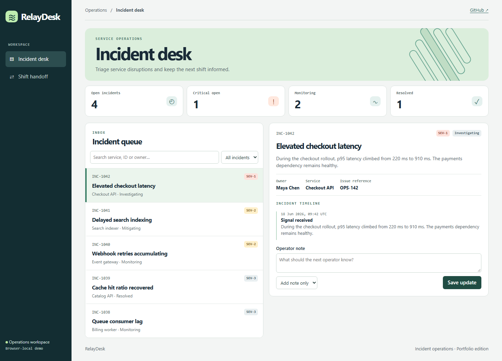

# RelayDesk

**Incident operations and shift handoff for a service team.** Follow a checkout incident from its first signal through mitigation, record an operator decision, then hand the next shift a briefing with the latest context.

[Open the interactive desk](https://mohamadmirzaei79.github.io/RelayDesk/) · [Incident API](api.py) · [Deployment chart](chart) · [Cross-service test](test_gateway.mjs)



## A two-minute walkthrough

1. Open **INC-1042**. Check severity, owner, affected service and issue reference together.
2. Add a mitigation note, choose **Mitigating**, then **Save update**. The decision appears on the incident timeline.
3. Open **Shift handoff**. The briefing includes the new stage and latest note. Filter the queue to **SEV-1** to return to the critical incident.

The public desk ships with five fictional incidents. Changes stay in the visitor's browser. The connected edition serves the same interface through a Node.js gateway and persists changes using a Python API.

## System design

| Component | Responsibility |
| --- | --- |
| Node.js gateway | Serves the operator UI, authenticates the local operator, forwards a bounded set of requests to FastAPI and times out stalled API calls. |
| FastAPI + Django ORM | Validates input, enforces one-stage transitions and commits the incident state, timeline entry and version together. Stale writes return HTTP 409. |
| PostgreSQL | Canonical incident ledger in Compose and Kubernetes. SQLite runs the same ledger for local tests. |
| MongoDB | A separate archive job writes versioned document snapshots. Re-running a snapshot replaces the same key. An archive outage does not block an incident update. |
| Chainlit | Answers **handoff** and incident-ID queries using the current API. The briefing works without an LLM account. |
| Prometheus + Grafana | Scrape API availability and committed changes. Compose provisions the datasource and the two-panel operations dashboard. |
| Jira Cloud | The read-only issue lookup resolves an incident's issue reference to its Jira status and summary using operator-supplied credentials. |
| Docker, Kubernetes, Helm, Argo CD and GitLab CI | Linux containers, a repeatable cluster deployment, a GitOps application and a pipeline that verifies the source and publishes tagged images. |

## Run the connected workspace

Use Docker Compose v2. Put three local secrets in an untracked `.env` file: `PGPASSWORD`, `RELAY_TOKEN` and `GRAFANA_PASSWORD`. Set each to a separately generated value. Then run:

```sh
docker compose up --build -d
docker compose --profile jobs run --rm archive
```

| Service | Local address | Try it |
| --- | --- | --- |
| Operator desk | http://localhost:8080 | Sign in as `operator` with `RELAY_TOKEN`, then update an incident. |
| Chainlit handoff | http://localhost:8001 | Send `handoff` or `INC-1042`. |
| Prometheus | http://localhost:9090 | Query `up{job="relaydesk"}`. |
| Grafana | http://localhost:3000 | Sign in as `admin` using `GRAFANA_PASSWORD` and open **RelayDesk / Operations**. |

The API, PostgreSQL and MongoDB are internal to the Compose network. The desk uses one shared operator credential. This deployment is intended for evaluation on a trusted workstation. A multi-tenant production rollout would need individual identity, role permissions, retention controls and backup policies.

### Jira issue lookup

Set `JIRA_URL`, `JIRA_EMAIL` and `JIRA_API_TOKEN` for your own Jira Cloud site, install the Python requirements, then run `python jira_lookup.py OPS-142`. The ticket keys in the public demo are examples.

## Verify locally

Requires Python 3.12 and Node.js 22 or later. The SQLite verification path needs only the API dependencies.

```sh
python -m pip install fastapi==0.116.1 Django==5.2.2 uvicorn==0.35.0 httpx prometheus-client
python -m unittest -v test_relay
node --test test_gateway.mjs
helm lint chart
helm template relaydesk chart
```

The service test starts a real gateway and API on loopback ports, submits a note, retries a stale update and reads back the committed timeline. Unit and API tests also cover missing credentials, invalid transitions, note-only updates, readiness and exported metrics.

## Cluster deployment

The chart deploys the API and gateway. Compose provides the full integration environment. Supply an existing PostgreSQL instance and a namespace secret named `relaydesk-env` containing `PGHOST`, `PGDATABASE`, `PGUSER`, `PGPASSWORD` and `RELAY_TOKEN`. Port 5432 is the default. Both Kubernetes Services are cluster-internal.

Build and push the two Dockerfile targets to your registry, then set their immutable image references in `chart/values.yaml`. For a local cluster you can load the images under the default `:local` tags. The pre-install job initializes and seeds the ledger before API startup.

```sh
helm upgrade --install relaydesk chart -n relaydesk
kubectl -n relaydesk port-forward svc/relaydesk-gateway 8080:8080
```

For GitOps, point [the Argo CD application](argocd.yaml) at your configured revision and sync it after the namespace secret is ready. [GitLab CI](.gitlab-ci.yml) runs on a GitLab mirror with runners and its registry enabled. Tagged releases build and push both image targets using a Docker-in-Docker runner.

## Verification scope

The public Pages edition runs the browser workflow. Local checks cover the Node-to-FastAPI write path with SQLite, API validation, Compose configuration and Helm rendering. The full Compose stack, external Jira tenant and Kubernetes rollout require their respective runtimes.
